# 19 referans tasarımın değerlendirmesi

Kullanıcının verdiği 19 referans görsel (bkz. `docs/BRIF.md`, bölüm 3) tek tek değerlendirildi. Her biri için oyunun **kendi varlıklarıyla** dikey bir sahne çizildi (`docs/referanslar/ref-NN.png`, kaynak: `preview/references.html`).

| # | Referans | Değerlendirme | Oyunda nerede | Sahne |
|---|---|---|---|---|
| 1 | Açık turkuaz suda küçük yosunlu kayalıklar ve Dev Balon Balığı | Uygun; ilk bölümün havası | Bölüm 1 resif adacıkları (%12–18) + Dev Balon Balığı arenası | 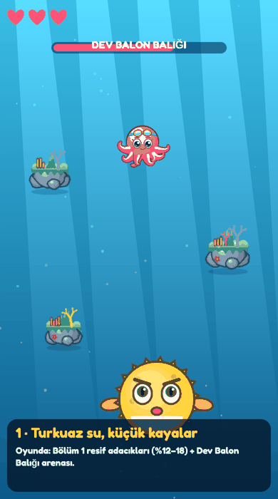 |
| 2 | Koyu derinlikte seyrek küçük kayalıklar ve büyük elektrikli denizanası | Uygun; derinlik hissi güçlü | 3. kademe renkleri, seyrek resif, denizanası savaşı, koyu deniz tabanı | 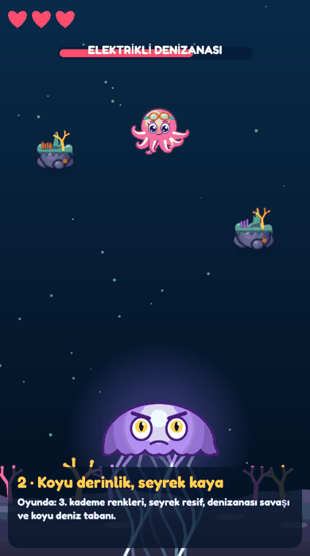 |
| 3 | Açık mavi aydınlatmalı, yosunlu büyük mercan oluşumları | Uygun; büyük kayalar ileri bölümlere | Bölüm 3+ büyük resifler (%24–28), kabarık yosun ve mercanlar | 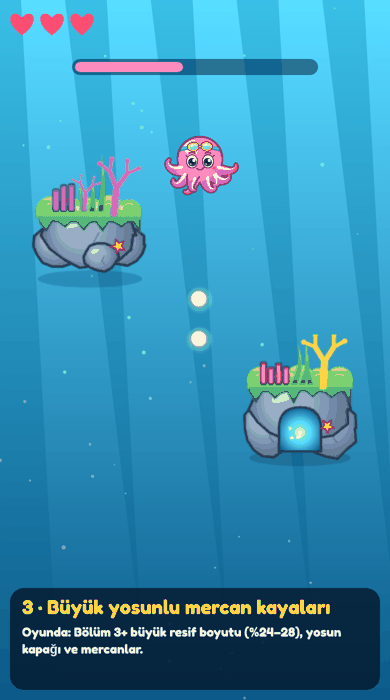 |
| 4 | Farklı yüksekliklerde sivri uçlu üç resif adacığı | Uygun; "askıda ada" hissi | Altı sivri resif türü (`spiky`) | 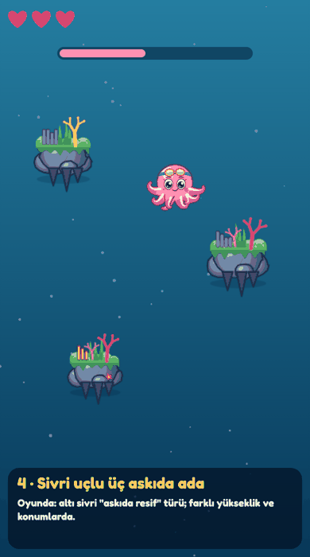 |
| 5 | Mercanlarla kaplı geniş taş platformlar ve denizanası bölgesi | Uygun; platformlar çıkıntı olarak | Mercan Kanyonu uzun çıkıntıları + denizanaları | 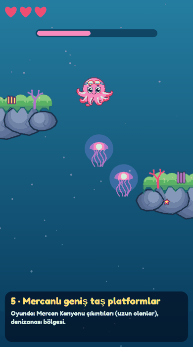 |
| 6 | Su altı mağarası biçimli kayalıklar ve açık yüzme koridoru | Uygun; ödül fırsatı | Mağaralı resif: parlayan ağza girince hazine; koridor garantisi | 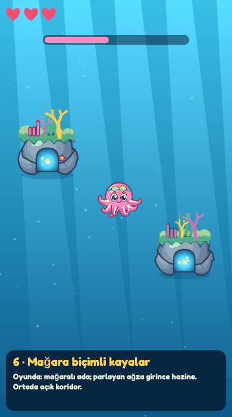 |
| 7 | Kenarlara yerleşmiş bitkili kaya kümeleri ve parlak deniz tabanı | Uygun | Açık su bölgelerinde kenarda tek resif; canavar arenasında kum tabanı | 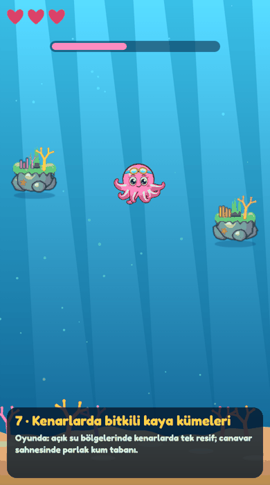 |
| 8 | Arka planda uzak resif silüetleri bulunan geniş açık su | Uygun; derinlik katmanı | Uzak katman (0,35x): resif silüetleri, balık sürüleri | 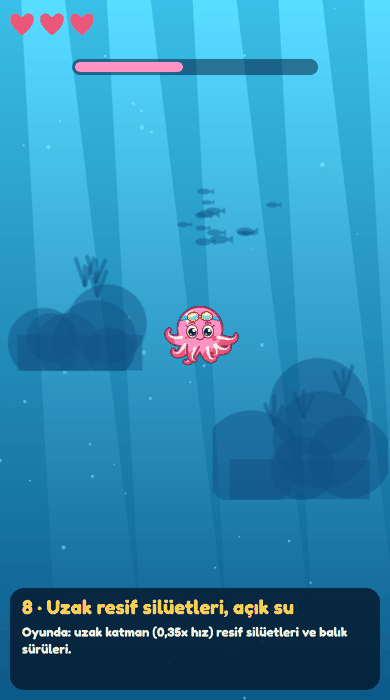 |
| 9 | Deniz yıldızları, kum tabanı ve seyrek asılı resifler | Uygun | Deniz yıldızı (mürekkebi doldurur), resif üstü yıldızlar, deniz tabanı | 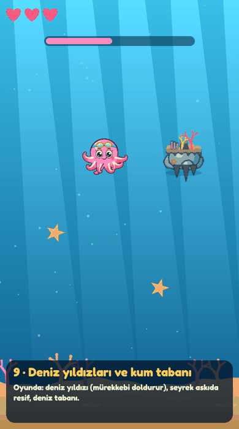 |
| 10 | Su altı batığı silüetinin eşlik ettiği üç askıda resif | Uygun; batık gemi ayrı bölge oldu | Uzak katmanda batık silüeti + Batık Gemi bölgesi (gizli oda, toplar) | 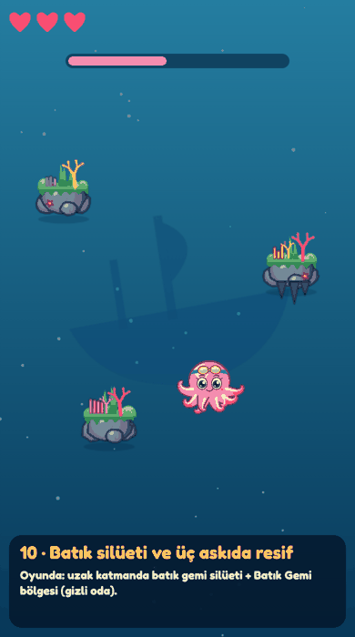 |
| 11 | Az sayıda kayalıkla sadeleştirilmiş denizanası savaş alanı | Uygun; savaşta sadelik | Canavar gelince kayalar arenadan hızla çekilir | 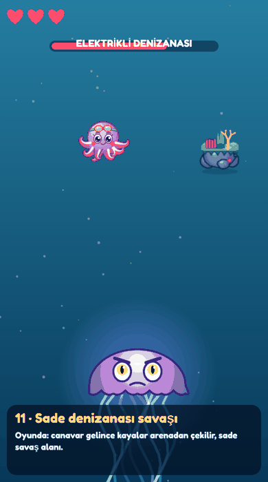 |
| 12 | Kayalık tüneller ve yoğun mercanlarla çevrili Dev Balon Balığı savaşı | Kısmen; tünel kanyon olarak | Mercan Kanyonu duvarları + Dev Balon Balığı | 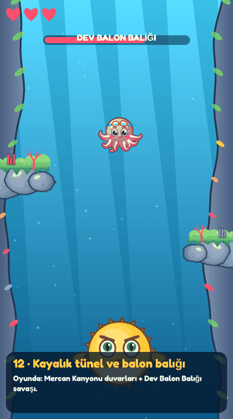 |
| 13 | Mercanlı mağara geçitleri ve denizanası bölümü | Uygun | Mağaralı resif + Karanlık Mağara bölgesi (ışıkla keşif) | 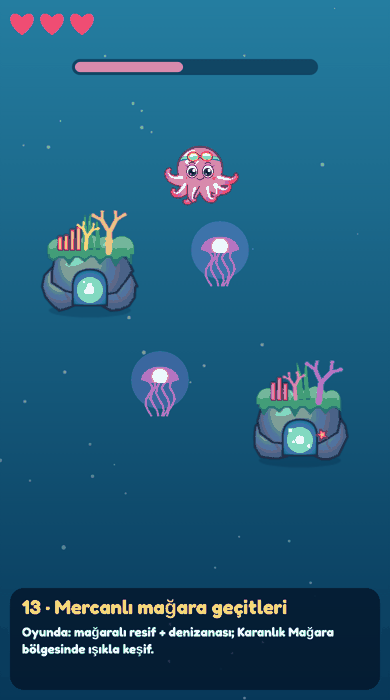 |
| 14 | Ekranın kenarlarından içeri uzanan büyük kaya çıkıntıları ve kanyon | Uygun; B tipi kayalık | Mercan Kanyonu: dekor duvar + küçük çarpışılabilir çıkıntılar | 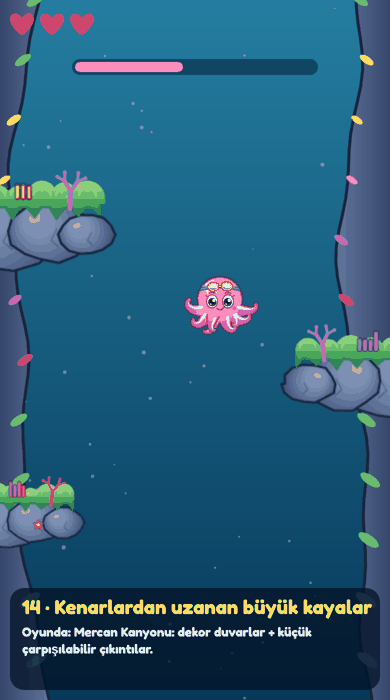 |
| 15 | Ortası açık, kenarlarda üç küçük resif bulunan sade ortam | Uygun; kural haline getirildi | En fazla 3 çarpışılabilir resif + her yükseklikte koridor kontrolü | 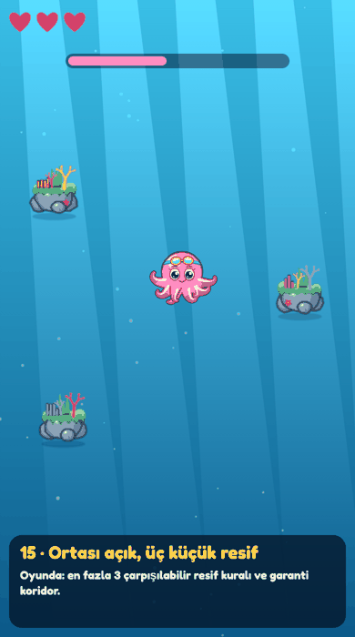 |
| 16 | Arayüzü sadeleştirilmiş, resiflerle çevrili denizanası karşılaşması | Kısmen; HUD korunmalı dendi | Yıldızlı ilerleme çubuğu, canavar can barı; HUD öğeleri korundu | 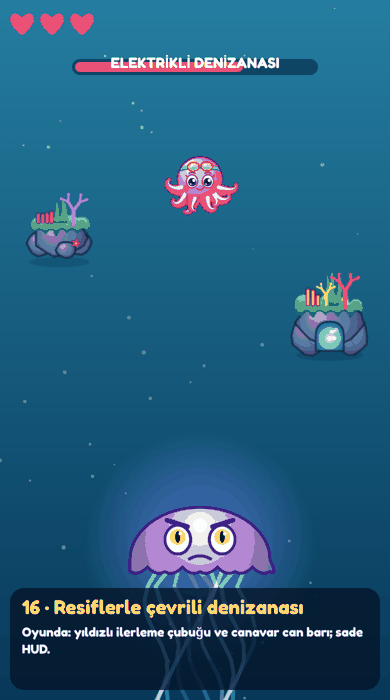 |
| 17 | Küçük su altı kaya adaları ve geniş hareket koridorları | Uygun | Bölüm 1 küçük boyutlar, geniş koridor | 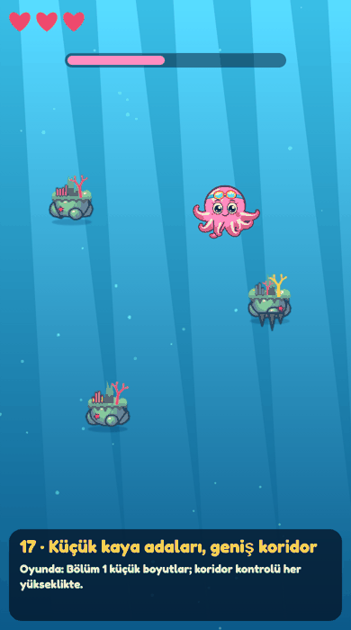 |
| 18 | Üç küçük resif, sevimli OKTO ve büyük başlat butonu | Uygun (menü) | Açılış ekranının büyük oyna düğmesi, sevimli Okto ve kostümler | 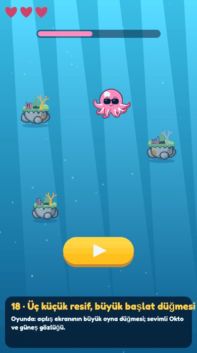 |
| 19 | Denizanası düşmanları ve kenarlarda mercanlı kayalıklarla açık dalış | Uygun | Açık dalış + kenar çıkıntıları; denizanaları mürekkeple sersemletilir | 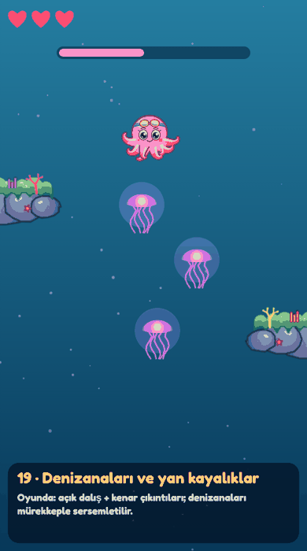 |

## Genel sonuç
- **Ana model:** 3, 6, 13, 16, 17, 19 (yosun kapaklı kayalar, mercan, deniz yıldızı, parlayan mağara ağzı).
- **A, askıda resifler:** 1, 4, 9, 10, 15, 17 · **B, yan kayalıklar / kanyon:** 5, 12, 14, 19.
- **Atmosfer:** 2 (derinlik), 7 ve 9 (deniz tabanı), 8 ve 10 (uzak katman silüetleri).
- Kullanıcı ilk tasarımları (1, 2, 5, 11) daha az beğendi; son tasarımların tarzı esas alındı.
